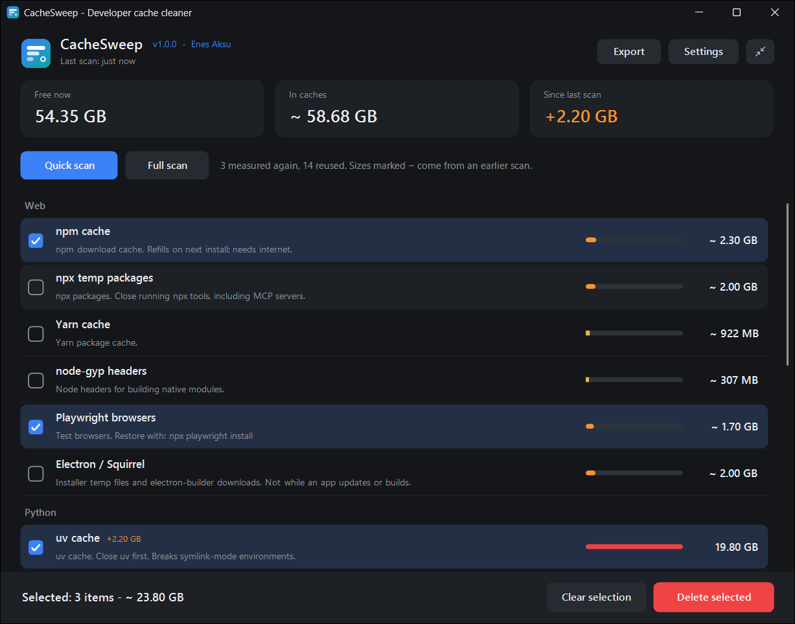
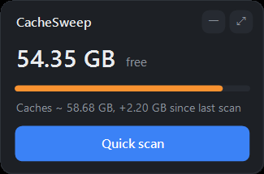
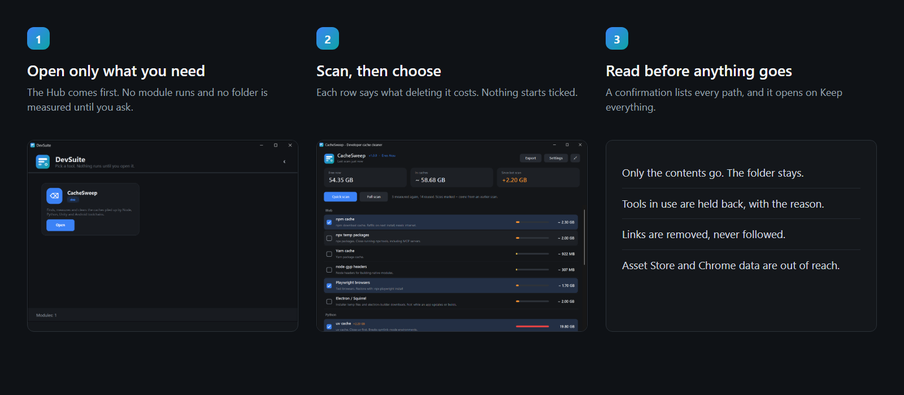

<div align="center">


# DevSuite

**See what your developer tools left on disk, and clear only what you choose.**

[](../../releases)
[](LICENSE)

[Turkish](docs/tr/README.tr.md) · [Documentation](DOCUMENTATION.md) · [Security](SECURITY.md)

</div>

---

Package managers, game engines and SDKs all keep caches, and none of them clean up after
themselves. Tens of gigabytes disappear with no obvious cause. DevSuite shows you where
they went, tells you what deleting each one will cost, and removes only what you pick
after you have read the exact list.

It is a small, native Windows program: no service, no start with Windows, no telemetry, no account,
no network access, nothing to install beyond what Windows already has.

<div align="center"></div>

## What you get

| | |
|---|---|
| **DevSuite Hub** | The screen that opens first. It lists your tools and starts one when you press Open. It does nothing else. |
| **CacheSweep** | Measures the caches of about thirty developer tools and clears the ones you select. |

Nothing runs until you ask. The Hub does not scan, and CacheSweep does not measure a
single folder until you press **Scan**.

## How it works

1. Open **DevSuite**, then open **CacheSweep** from it.
2. Press **Scan**. Every location is measured at the same time, so the wait is the slowest
   folder rather than the sum of all of them. You can cancel at any point.
3. Tick what you want gone. Nothing starts ticked, and each row says what deleting it
   costs you.
4. Read the confirmation window. It lists every path, and it opens on **Keep everything**.
5. Only then is anything removed. The folder itself stays; only its contents go.

The next time you open it, CacheSweep shows the last result at once, without measuring
anything. **Quick scan** re-measures only the folders that look changed, and **Full scan** measures
everything. A size reused from an earlier scan is marked with `~`, because a change deep inside
a folder can go unnoticed. Selected folders are always measured again before the confirmation.

You can shrink the window to a small panel or a round icon and drag it anywhere. Both stay on
top and show free disk space live, which costs almost nothing. Neither measures a folder until
you press Quick scan, and deleting always happens in the full window.

<div align="center"></div>

<div align="center"></div>

## What it can clear

| Group | Locations |
|---|---|
| Web | npm, npx, pnpm\*, Yarn, node-gyp, Playwright browsers, Vercel CLI, Electron and Squirrel |
| Python | uv, pip, conda\* |
| Unity | package cache, editor cache, Hub cache, Accelerator\*, rotated log files |
| Mobile | Gradle, Android NDK\*, emulator\*, sources\*, build-tools\* |
| Other | NuGet, Cargo, Go modules |
| System | your Temp folder, crash dumps, DirectX and NVIDIA shader caches, Windows Temp\* |

\* Advanced: hidden until you turn them on in Settings, because getting them back takes
real effort. Windows Temp also needs the program to run as administrator.

You can add your own folders too. Each one has to pass the guard described below.

## Built so it cannot hurt you

- **Nothing deletes on its own.** No schedule, no background cleaning, nothing ticked in
  advance, and a confirmation listing every path each time.
- **Some data is out of reach.** Unity Asset Store downloads and the `User Data` folder of
  every Chrome channel are protected by path, and every item is checked against them right
  before it goes.
- **Paths are judged by where they really lead.** A junction, symlink or substituted drive
  pointing at a protected or refused folder is refused too, and a path that cannot be
  resolved is refused rather than trusted.
- **Your folders are checked three times:** when added, when settings load, and right
  before deleting. Drive roots, your profile, Documents, AppData, credential folders such as
  `.ssh`, Windows, Program Files, and anything that looks like a project are refused.
- **Tools in use are left alone.** If the program that owns a cache is running, that cache
  is held back and the confirmation window says why.
- **Links are never followed.** A junction or symlink inside a cache is unlinked; what it
  points at is not touched.
- **Recent and shared files are kept.** Temp files newer than seven days are kept, as are `_npx`
  folders and the browser profiles some tools keep beside Playwright.
- **Recycle Bin is an option you can read about.** Items too large for the bin are deleted
  for good, and the confirmation window says so.

The guard is a set of rules, not a proof. Something precious placed by hand inside a cache
folder looks like cache. Read the list before you confirm. Details are in
[SECURITY.md](SECURITY.md).

## Download

| | |
|---|---|
| **Setup** | [`DevSuite-x.y.z-setup.exe`](../../releases/latest): installs for your user only, no administrator rights |
| **Portable** | [`DevSuite-x.y.z-portable.zip`](../../releases/latest): unzip, run `DevSuiteHub.exe` |
| **Portable, Turkish** | [`DevSuite-x.y.z-portable-tr.zip`](../../releases/latest): same programs plus `lang.json` |

Requires Windows 10 or 11. The .NET Framework it runs on already ships with Windows.

Releases are not code-signed yet, so SmartScreen warns on first run: **More info, then Run
anyway**. Each release includes `SHA256SUMS.txt` so you can verify what you downloaded, and
everything here can be built from source in a minute.

## Build from source

No SDK, no packages, no internet. The compiler already on your machine does the work.

```bat
BUILD.bat
```

This writes the programs to `dist\` and the Turkish package to `dist-tr\`, and touches
nothing else on your disk. The tests open no window and delete only their own fixtures:

```bat
powershell -NoProfile -ExecutionPolicy Bypass -File tests\GuardTests.ps1
powershell -NoProfile -ExecutionPolicy Bypass -File tests\HubTests.ps1
powershell -NoProfile -ExecutionPolicy Bypass -File tests\MemoryTests.ps1
```

## Experimental extras

MCP Control, MCP Setup and Skill Manager edit the configuration of AI coding clients. They
are not part of the release, are never installed, and are built only on request with
`BUILD.bat -Extras`. Read [extras/README.md](extras/README.md) first: it lists the known
problems that keep them out.

## Translations

The programs are English. A translation is a `lang.json` file beside them. To add a
language, copy `lang/tr.json`, translate the values, and save it next to the programs as
`lang.json`.

## Project layout

```
hub/                   the first screen
apps/<Name>/           one folder per module, each with an app.json manifest
shared/                design tokens, window chrome, components, the logo
extras/                experimental tools, not part of a release
lang/                  language packs
tests/                 guard, sweeper, hub and scan memory tests
tools/build.ps1        the build, driven by the manifests
installer/             Inno Setup script
```

[DOCUMENTATION.md](DOCUMENTATION.md) explains why it is built this way.

## License

[MIT](LICENSE) © 2026 Enes Aksu
