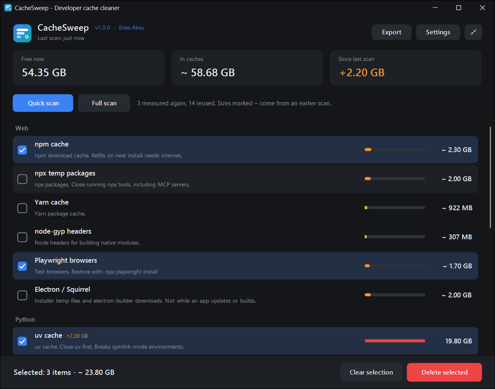
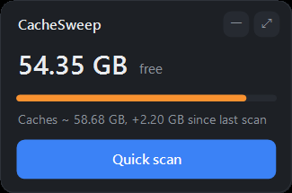

<div align="center">


# DevSuite

**Geliştirici araçlarının diskte ne bıraktığını gör, yalnızca seçtiğini temizle.**

[English](../../README.md) · [Teknik dokümantasyon](DOCUMENTATION.tr.md)

</div>

---

Paket yöneticileri, oyun motorları ve SDK'lar önbellek tutar, hiçbiri de arkasını
toplamaz. Onlarca gigabayt görünür bir sebep olmadan kaybolur. DevSuite bu alanın nereye
gittiğini gösterir, her birini silmenin sana neye mal olacağını söyler ve tam listeyi
okuduktan sonra yalnızca seçtiklerini kaldırır.

Küçük, yerel bir Windows programıdır: servis yok, Windows ile başlamaz, telemetri yok, hesap yok, ağ
erişimi yok, Windows'ta zaten olanın dışında kurulacak bir şey yok.

<div align="center"></div>

## İçinde ne var

| | |
|---|---|
| **DevSuite Hub** | İlk açılan ekran. Araçlarını listeler, Aç'a bastığında birini başlatır. Başka bir şey yapmaz. |
| **CacheSweep** | Yaklaşık otuz geliştirici aracının önbelleğini ölçer, seçtiklerini temizler. |

Sen istemeden hiçbir şey çalışmaz. Hub tarama yapmaz; CacheSweep de sen **Tara**'ya
basmadan tek bir klasörü ölçmez.

## Nasıl çalışır

1. **DevSuite**'i aç, oradan **CacheSweep**'i aç.
2. **Tara**'ya bas. Tüm konumlar aynı anda ölçülür, yani bekleme süresi hepsinin toplamı
   değil en yavaş klasör kadardır. İstediğin an iptal edebilirsin.
3. Silmek istediklerini işaretle. Hiçbiri işaretli gelmez ve her satır silmenin neye mal
   olacağını söyler.
4. Onay penceresini oku. Her yolu listeler ve **Hiçbirini silme** seçili açılır.
5. Ancak o zaman bir şey silinir. Klasörün kendisi kalır, yalnızca içi gider.

Bir sonraki açılışta CacheSweep hiçbir şey ölçmeden son sonucu hemen gösterir. **Hızlı tara**
yalnızca değişmiş görünen klasörleri yeniden ölçer, **Tam tara** hepsini ölçer. Önceki taramadan
gelen boyutlar `~` ile işaretlenir, çünkü klasörün derinindeki bir değişiklik fark edilmeyebilir.
Seçilen klasörler onaydan önce her zaman yeniden ölçülür.

Pencereyi küçük bir panele veya yuvarlak bir simgeye küçültüp istediğin yere sürükleyebilirsin.
İkisi de üstte kalır ve boş diski canlı gösterir; bunun maliyeti neredeyse yoktur. Sen Hızlı
tara'ya basmadan klasör ölçmezler, silme her zaman tam pencerede yapılır.

<div align="center"></div>

## Neleri temizleyebilir

| Grup | Konumlar |
|---|---|
| Web | npm, npx, pnpm\*, Yarn, node-gyp, Playwright tarayıcıları, Vercel CLI, Electron ve Squirrel |
| Python | uv, pip, conda\* |
| Unity | paket önbelleği, editör önbelleği, Hub önbelleği, Accelerator\*, eski log dosyaları |
| Mobil | Gradle, Android NDK\*, emülatör\*, kaynaklar\*, build-tools\* |
| Diğer | NuGet, Cargo, Go modülleri |
| Sistem | Temp klasörün, hata dökümleri, DirectX ve NVIDIA gölgelendirici önbellekleri, Windows Temp\* |

\* Gelişmiş: Ayarlar'dan açana kadar gizlidir, çünkü geri getirmek gerçek bir emek ister.
Windows Temp için ayrıca programın yönetici olarak çalışması gerekir.

Kendi klasörlerini de ekleyebilirsin. Her biri aşağıdaki denetimden geçmek zorundadır.

## Sana zarar veremeyecek şekilde kuruldu

- **Hiçbir şey kendiliğinden silinmez.** Zamanlama yok, arka planda temizlik yok, önceden
  işaretli öğe yok, her seferinde her yolu listeleyen bir onay var.
- **Bazı veriler erişim dışıdır.** Unity Asset Store indirmeleri ve her Chrome kanalının
  `User Data` klasörü yol düzeyinde korunur; her öğe silinmeden hemen önce bunlarla
  karşılaştırılır.
- **Yollar gerçekte nereye çıktıklarına göre değerlendirilir.** Korumalı veya reddedilen bir
  klasöre giden junction, symlink ya da `subst` sürücüsü de reddedilir; çözümlenemeyen bir
  yola güvenilmez, o da reddedilir.
- **Kendi klasörlerin üç kez denetlenir:** eklenirken, ayarlar yüklenirken ve silmeden hemen
  önce. Sürücü kökleri, profilin, Belgeler, AppData, `.ssh` gibi kimlik bilgisi klasörleri,
  Windows, Program Files ve proje gibi görünen her şey reddedilir.
- **Kullanımdaki araçlara dokunulmaz.** Önbelleğin sahibi olan program çalışıyorsa o önbellek
  bekletilir, onay penceresi de nedenini söyler.
- **Bağlantılar takip edilmez.** Önbellek içindeki junction veya symlink yalnızca kaldırılır;
  gösterdiği yere dokunulmaz.
- **Yeni ve paylaşılan dosyalar korunur.** Yedi günden yeni Temp dosyaları, `_npx` klasörleri ve
  bazı araçların Playwright yanında tuttuğu tarayıcı profilleri korunur.
- **Geri Dönüşüm Kutusu hakkında açık konuşur.** Kutuya sığmayan öğeler kalıcı olarak silinir,
  onay penceresi de bunu söyler.

Denetim bir kural listesidir, kanıt değil. Önbellek klasörüne elle konmuş değerli bir şey
önbellek gibi görünür. Onaylamadan önce listeyi oku. Ayrıntılar
[SECURITY.md](../../SECURITY.md) dosyasında.

## İndirme

| | |
|---|---|
| **Kurulum** | [`DevSuite-x.y.z-setup.exe`](../../../../releases/latest): yalnızca senin kullanıcın için kurulur, yönetici yetkisi istemez |
| **Taşınabilir** | [`DevSuite-x.y.z-portable.zip`](../../../../releases/latest): çıkart, `DevSuiteHub.exe`'yi çalıştır |
| **Taşınabilir, Türkçe** | [`DevSuite-x.y.z-portable-tr.zip`](../../../../releases/latest): aynı programlar ve `lang.json` |

Windows 10 veya 11 gerekir. Üzerinde çalıştığı .NET Framework Windows ile birlikte gelir.

Sürümler henüz kod imzalı değil, bu yüzden SmartScreen ilk çalıştırmada uyarır: **Daha fazla
bilgi, sonra Yine de çalıştır**. Her sürümde indirdiğini doğrulayabilmen için
`SHA256SUMS.txt` bulunur ve her şey kaynaktan bir dakikada derlenebilir.

## Kaynaktan derleme

SDK yok, paket yok, internet yok. İşi bilgisayarında zaten bulunan derleyici yapar.

```bat
BUILD.bat
```

Programları `dist\`, Türkçe paketi `dist-tr\` içine yazar; diskte başka hiçbir şeye dokunmaz.
Testler pencere açmaz ve yalnızca kendi deneme dosyalarını siler:

```bat
powershell -NoProfile -ExecutionPolicy Bypass -File tests\GuardTests.ps1
powershell -NoProfile -ExecutionPolicy Bypass -File tests\HubTests.ps1
powershell -NoProfile -ExecutionPolicy Bypass -File tests\MemoryTests.ps1
```

## Deneysel ekler

MCP Control, MCP Setup ve Skill Manager, yapay zekâ kodlama istemcilerinin ayarlarını
düzenler. Sürüme dahil değildir, asla kurulmaz ve yalnızca istenirse `BUILD.bat -Extras` ile
derlenir. Önce [extras/README.md](../../extras/README.md) dosyasını oku: onları dışarıda
tutan bilinen sorunları listeler.

## Çeviriler

Programlar İngilizcedir. Çeviri, yanlarında duran bir `lang.json` dosyasıdır. Yeni dil
eklemek için `lang/tr.json` dosyasını kopyala, değerleri çevir ve programların yanına
`lang.json` olarak kaydet.

## Lisans

[MIT](../../LICENSE) © 2026 Enes Aksu
